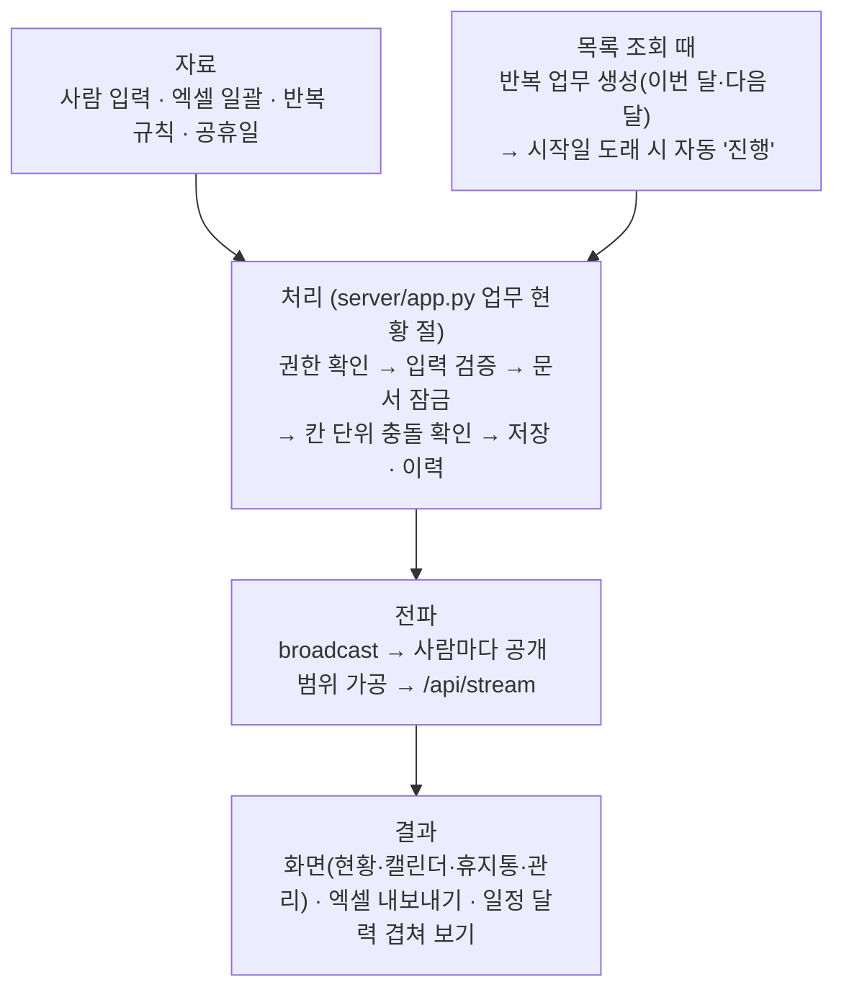

# 업무 현황 · 개발 문서

자금팀 AX 포털 안의 **「업무 현황」** 기능을 만든 사람이 없어도 유지보수·인수인계할 수 있도록 구조·데이터·배포·운영 방법을 정리한 문서입니다.

!!! note "이 문서의 기준"
    - 코드 저장소 `SinokorOfficial/ax-fnc`(비공개) `develop` 가지, 맨 위 커밋 `7e56f08`(2026-10-26 확인).
    - 코드에서 확인한 것만 적었습니다. 코드로 확인하지 못한 것은 **「확인 필요」**로 표시했습니다.
    - 기능 규약 원문은 저장소의 `docs/tasks.md` 입니다. 이 문서는 그 규약을 코드와 대조해 구조 중심으로 다시 정리한 것입니다.
    - 공개판이므로 사내망 주소·계정·실명은 싣지 않습니다.

## 한 줄 목적

자금팀 업무 중 **기한이 있는 일**(원리금 상환, 공시, 정기예금 만기 처리 등)을 한곳에 모아 **누가·언제까지·어떤 상태인지** 보여 주는 기능입니다.
매달 반복되는 일은 「반복 규칙」으로 등록해 두면 업무가 자동으로 만들어집니다.
별도 서버가 아니라 **자금팀 AX 포털(ax-fnc) 안의 메뉴 하나**이고, 로그인·계정·권한은 포털의 것을 그대로 씁니다.

## 한눈에 보는 흐름

## 쓰는 빈도

- 화면을 열 때마다(`GET /api/tasks`) 이번 달·다음 달 반복 업무 생성과 시작일 자동 진행이 돕니다. **예약 작업(스케줄러)은 없습니다.**
- 실제 사용 빈도·사용자 수: **확인 필요**(코드에 집계 없음).

## 문서 지도

| 알고 싶은 것 | 페이지 |
|---|---|
| 누가 무엇을 할 수 있나 | [권한](rbac.md) |
| 자료가 어디서 들어와 무엇이 나가나 | [자료 원천·결과물](sources.md) |
| 어느 파일을 고치나, 내 PC에서 띄우는 법 | [코드 위치·로컬 실행](code.md) |
| 저장 모양·칸의 뜻 | [데이터 모델](data-model.md) |
| 라우트 전체 | [API](api.md) |
| 반복 업무 자동 생성 규칙 | [반복 규칙 생성](generate.md) |
| 동시 수정·잠금 | [동시성·충돌](concurrency.md) |
| 실시간 반영과 공개 범위 | [실시간(SSE)](sse.md) |
| 화면 코드 구조 | [화면 모듈](frontend.md) |
| 운영에 올리는 순서 | [배포·운영](deployment.md) |
| 시험 돌리는 법 | [시험](testing.md) |
| 아직 없는 것·알려진 한계 | [알려진 한계·2단계](limits.md) |
| 지금까지 바뀐 것 | [변경 이력](changelog.md) |
